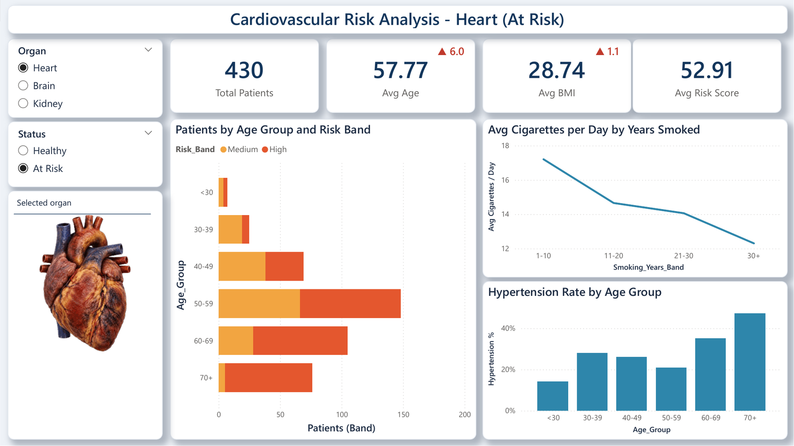

# Cardiovascular Risk Explorer

An interactive **Power BI** dashboard for exploring cardiovascular risk factors
(age, BMI, smoking, blood pressure, cholesterol) alongside heart attack, stroke and kidney disease.

Pick an organ (**Heart / Brain / Kidney**) and a status (**Healthy / At Risk**) and the whole
report updates together: the organ image, the KPI cards and every chart.



> **About the data.** The dataset is **synthetic**: 1,200 patients generated by a reproducible
> Python script ([`scripts/generate_data.py`](scripts/generate_data.py)). Its fields and risk factors are
> modelled on the public health datasets commonly shared on [Kaggle](https://www.kaggle.com/datasets),
> such as stroke-prediction and heart-attack / heart-disease datasets, with realistic relationships
> built in (e.g. more years smoked and higher blood pressure raise the risk of heart attack and stroke).
> Because those relationships were coded into the generator, the patterns in the charts show how the
> dashboard works; they are not findings about real patients.
> No real patient data is used, and the dashboard is a portfolio/learning project, not a clinical tool.

---

## What's on the dashboard

| Area | Shows |
|---|---|
| Slicers | Organ (Heart / Brain / Kidney) and Status (Healthy / At Risk) |
| KPI cards | Total patients, average age, average BMI, average risk score |
| vs average | ▲ / ▼ difference from the overall average age and BMI (red = higher, green = lower) |
| Organ image | Healthy or damaged version of the selected organ |
| Title banner | Updates with the selection, e.g. "Cardiovascular Risk Analysis - Heart (At Risk)" |
| Patients by Age Group and Risk Band | Stacked bar chart: Low (green) / Medium (amber) / High (red) risk |
| Avg Cigarettes per Day by Years Smoked | Line chart (smokers only) |
| Hypertension Rate by Age Group | Column chart, % of patients with hypertension |

---

## Quick start (just view the dashboard)

**You need:** Windows and [Power BI Desktop](https://www.microsoft.com/power-platform/products/power-bi/desktop) (free).

1. Download this repo: **Code > Download ZIP**, then unzip it (or `git clone` it).
2. Open `powerbi/cardiovascular-risk-explorer.pbix` in Power BI Desktop.
3. Click the slicers on the left.

That's it. The data and images are saved inside the `.pbix`, so the report works straight away.

---

## Refreshing the data on your computer

The report remembers the folder it was built in. If you click **Refresh** on another computer,
you'll get a *"could not find file"* error until you point it at your copy of the project.
Do this once:

### 1. Fix the three CSV sources
1. **Home > Transform data > Data source settings**.
2. For each of `patients.csv`, `dim_organ.csv` and `dim_status.csv`: select it, click
   **Change Source...**, and browse to the file in your `data/clean/` folder.
3. Click **Close**.

### 2. Fix the image folder
1. **Home > Transform data** (opens Power Query).
2. Select the **organ_images** query, then **Home > Advanced Editor**.
3. On the `Source = Folder.Files("...")` line, replace the path with your own path to
   `assets\organs\powerbi`, for example:
   ```
   Source = Folder.Files("C:\Users\<you>\Downloads\cardiovascular-risk-explorer\assets\organs\powerbi"),
   ```
4. **Done**, then **Close & Apply**.

Now **Refresh** works.

---

## Regenerating the data (optional)

Requires Python 3.9+.

```bash
pip install -r requirements.txt
python scripts/generate_data.py --n 1200 --seed 42
```

This rewrites the CSVs in `data/`. The same `--seed` always gives the same data. Change `--n`
for more or fewer patients, then **Refresh** in Power BI.

## Replacing the organ images (optional)

1. Put six transparent PNGs in `assets/organs/` with exactly these names:
   `heart_healthy.png`, `heart_damaged.png`, `brain_healthy.png`, `brain_damaged.png`,
   `kidney_healthy.png`, `kidney_damaged.png`.
2. Make the small copies that the report embeds:
   ```bash
   python scripts/prepare_images.py
   ```
3. **Refresh** in Power BI.

---

## Project structure

```
cardiovascular-risk-explorer/
├── powerbi/
│   ├── cardiovascular-risk-explorer.pbix   the report
│   ├── measures.dax                        all DAX measures + calculated columns (for reference)
│   ├── organ_images.pq                     Power Query code for the image table
│   └── theme.json                          report colour theme (View > Themes > Browse for themes)
├── data/
│   ├── raw/patients_raw.csv                generated source fields
│   └── clean/
│       ├── patients.csv                    main table (1 row per patient)
│       ├── dim_organ.csv                   Organ slicer values
│       └── dim_status.csv                  Status slicer values
├── scripts/
│   ├── generate_data.py                    creates the synthetic dataset
│   └── prepare_images.py                   resizes organ images for Power BI
├── assets/organs/                          original organ images
│   └── powerbi/                            small copies embedded in the report
├── docs/
│   ├── dashboard.png                       screenshot for this README
│   └── dashboard.pdf                       PDF export of the report
├── requirements.txt
└── LICENSE
```

---

## How it works

### Data model
- `patients` holds all the data.
- `dim_organ` and `dim_status` feed the two slicers. They are **deliberately not related** to
  `patients`. The measures read what's selected and filter `patients` themselves.
- `organ_images` holds the six images as base64 text, split into chunks.

### Key measures
- `Selected Organ` / `Selected Status`: read the slicer selections.
- `Organ Status Match`: 1 when a patient's `Heart_Status`, `Brain_Status` or `Kidney_Status`
  (whichever organ is selected) matches the selected status.
- `Total Patients`, `Avg Age`, `Avg BMI`, `Avg Risk Score` and the chart measures filter
  `patients` with `Organ Status Match = 1`.
- `Organ Image`: rebuilds the selected image as a `data:image/png;base64,...` string. Its data
  category is set to **Image URL**, so Power BI draws it as a picture, with no web hosting needed.

All measures are listed in [`powerbi/measures.dax`](powerbi/measures.dax).

### How "At Risk" is defined
| Organ | At Risk when |
|---|---|
| Heart | `Heart_Attack = 1` |
| Brain | `Stroke = 1` |
| Kidney | `Kidney_Disease = 1` |


---

## Data dictionary (`data/clean/patients.csv`)

| Column | Meaning |
|---|---|
| PatientID | P0001, P0002, ... |
| Age, Age_Group | Years; `<30`, `30-39` ... `70+` |
| Gender | Male / Female |
| BMI, BMI_Category | Underweight / Normal / Overweight / Obese |
| Smoking_Status | Never / Former / Current |
| Smoking_Years, Smoking_Years_Band | Years smoked; None, 1-10, 11-20, 21-30, 30+ |
| Cigarettes_Per_Day, Daily_Intake_Band | None, 1-10, 11-20, 20+ |
| Alcohol_Units_Week | Units per week |
| Physical_Activity | Low / Moderate / High |
| Diet_Quality | Poor / Average / Good |
| Systolic_BP, Hypertension | mmHg; Yes if ≥ 140 |
| Cholesterol, Cholesterol_Level | mg/dL; Normal / Borderline / High |
| Diabetes, Family_History | Yes / No |
| Heart_Attack, Stroke, Kidney_Disease | 0 / 1 outcomes |
| Risk_Score, Risk_Band | 0-100; Low (≤20) / Medium (≤40) / High |
| Heart_Status, Brain_Status, Kidney_Status | Healthy / At Risk |

---

## Credits

- Dashboard, data generator and documentation: **Kwenev Stephen**
- Organ images: AI-generated with **ChatGPT**
- Dataset design: modelled on stroke and heart-disease datasets published on Kaggle; all values are synthetic.
- Inspired by a Power BI "Smoking Health Risk Analysis" dashboard.

## License

Released under the [MIT License](LICENSE). You can reuse, modify and share it; just keep the copyright notice.
